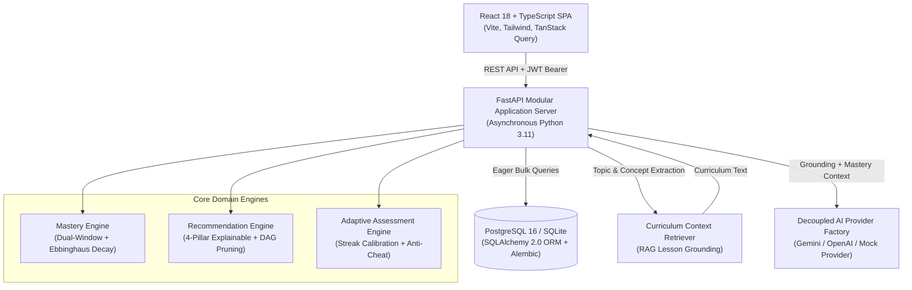

# AI-Powered Personalized Learning System (LearnAI)

[](.github/workflows/ci.yml)
[](backend/tests)
[](frontend/src/test)
[](frontend/e2e)
[](https://fastapi.tiangolo.com)
[](https://react.dev)
[](https://www.typescriptlang.org)
[](https://tailwindcss.com)
[](docker-compose.yml)

An interview-ready, production-grade full-stack web application delivering personalized, adaptive learning through knowledge mastery modeling, explainable recommendation intelligence, dynamic adaptive quizzing, curriculum-grounded Socratic tutoring, and enterprise security safeguards.

---

## 🎯 Value Proposition & Problem Statement

**The Problem**: Traditional online learning platforms treat all students identically—presenting static linear content, opaque recommendations, lifetime score averaging that penalizes early mistakes, and ungrounded LLM chatbots prone to hallucinations.

**The Solution**: **LearnAI** is an intelligent, adaptive educational platform that models real student comprehension using:
1. **Dual-Window Bayesian Knowledge Modeling**: Balances historical retention with recent mastery while accounting for item difficulty and Ebbinghaus memory decay.
2. **4-Pillar Explainable Recommendations**: Every suggestion explicitly tells the student **WHAT** to do, **WHY** it was chosen, the diagnostic **EVIDENCE** behind it, and the concrete **ACTION** required.
3. **Adaptive Assessment Engine**: Dynamically shifts question difficulty in real time based on response patterns while locking out client-side cheating.
4. **Curriculum-Grounded RAG Architecture**: Grounds the AI Socratic Tutor in actual database-backed lessons to eliminate hallucinations.

---

## 🌟 Key Features

1. **Dual-Window Knowledge Mastery Engine**:
   - Models student competence per topic using a weighted blend of recent accuracy (65%) and historical accuracy (35%).
   - Factors question difficulty bonus multipliers (`EASY: 0.85x`, `MEDIUM: 1.0x`, `HARD: 1.25x`), spaced retention decay, and asymptotic confidence estimation.
   - Includes real-time Ebbinghaus forgetting curve decay ($R = e^{-d / 14}$) automatically calculated and persisted for students inactive over 7 days.
   - Categorizes mastery across 4 tiers: **Beginner** (0–39%), **Developing** (40–59%), **Proficient** (60–79%), and **Mastered** (80–100%).

2. **4-Pillar Explainable Recommendation Engine**:
   - Replaces "black box" recommendations with transparent, deterministic reasoning answering:
     - **"What should I learn next?"**
     - **"Why is this recommended?"**
   - Every recommendation yields:
     - **WHAT**: Specific target topic and curriculum milestone.
     - **WHY**: Pedagogical rationale based on mastery score and tier.
     - **EVIDENCE**: Quantitative diagnostic data and recurring mistake tags.
     - **ACTION**: Concrete prescriptive next steps.
   - Enforces DAG prerequisite traversal with graph cycle detection and pruning.

3. **Real-Time Adaptive Assessment Engine**:
   - Calibrates initial question difficulty according to the student's mastery profile.
   - Dynamically shifts difficulty (`EASY` $\leftrightarrow$ `MEDIUM` $\leftrightarrow$ `HARD`) during quiz progression based on consecutive answer streaks.
   - Prioritizes questions mapped to active student `weak_concepts`.
   - Authoritative backend grading with anti-cheat protection (zero answer leakage in client responses) and submission idempotency.

4. **Curriculum-Grounded Socratic AI Tutor (RAG-Enabled)**:
   - Decoupled `AIProvider` architecture supporting Google Gemini, OpenAI, and a built-in Mock fallback.
   - `LearningContextRetriever` extracts relevant lesson summaries and concepts from the database, grounding responses in actual course material.
   - Injects student telemetry (mastery level, weak concepts, topic) directly into tutoring context.
   - Delivers step-by-step guidance, code breakdowns, conceptual hints, and follow-up check questions.

5. **Personalized Weekly Study Plans**:
   - Automatically scheduled study milestones targeting weak concepts across Monday–Sunday.
   - Interactive checklist with live completion tracking and granular telemetry event logging.

6. **Comprehensive Analytics & Telemetry**:
   - Interactive charts built with Recharts (Topic mastery distribution, score progression line chart, 7-day activity metrics).
   - Real-time streak counter and weak vs. strong concept attribution.

7. **Educator & Administrator Portal**:
   - Cohort overview metrics: Platform average mastery, student count, quiz attempts.
   - Student cohort roster with individual mastery performance.
   - Question bank management with on-demand AI Question Generator modal.

8. **Enterprise Security & Reliability**:
   - Hardened RBAC: Public registration strictly locked to `STUDENT` role (privilege escalation immunity).
   - In-depth IDOR defenses: Strict student ownership validation on quiz attempts, study plans, and recommendations.
   - Security headers middleware (`X-Content-Type-Options: nosniff`, `X-Frame-Options: DENY`, `X-XSS-Protection`, `Referrer-Policy`).
   - Deep `/health` diagnostic probe verifying live database connectivity (`SELECT 1`) and AI provider readiness.
   - Centralized exception handler preventing internal stack trace leaks to the client.

---

## 🏛️ System Architecture



---

## 🏗️ Technology Stack

| Layer | Technologies |
| :--- | :--- |
| **Frontend** | React 18, TypeScript, Vite, Tailwind CSS, TanStack Query, React Router v6, Axios, Recharts, Lucide Icons |
| **Backend** | Python 3.11, FastAPI, Pydantic v2, SQLAlchemy 2.0 (with eager loading & bulk queries), Alembic, python-jose (JWT), bcrypt |
| **Database** | PostgreSQL 16 (Production & Docker) / SQLite (Local zero-config dev & tests) |
| **AI Integration** | Decoupled Provider Pattern (`GeminiProvider`, `OpenAIProvider`, `MockAIProvider`), RAG Curriculum Grounding (`LearningContextRetriever`) |
| **Testing** | Pytest (26 backend tests), Vitest (16 frontend tests), Playwright (5 real browser E2E workflows) |
| **DevOps & CI** | Docker, Docker Compose, Nginx reverse proxy, GitHub Actions CI workflow |

---

## 🚀 Quick Start Guide

### Prerequisites
- Python 3.11+
- Node.js 20+

### Option A: Local Run (Zero-Config Development)

#### 1. Backend Setup
```bash
# Navigate to backend and activate virtualenv
cd backend
# Windows:
.\.venv\Scripts\activate
# Linux/macOS:
source .venv/bin/activate

# Apply migrations
python -m alembic upgrade head

# Seed realistic demo curriculum and telemetry
python scripts/seed_data.py

# Start FastAPI server
uvicorn app.main:app --reload --host 0.0.0.0 --port 8000
```
Backend API will be accessible at: `http://localhost:8000`  
Interactive Swagger API Docs: `http://localhost:8000/docs`  
Health Probe: `http://localhost:8000/health`

#### 2. Frontend Setup
```bash
cd frontend

# Install dependencies
npm install

# Start Vite dev server
npm run dev
```
Frontend will be accessible at: `http://localhost:5173`

---

### Option B: Docker Compose (Full Stack with PostgreSQL)

```bash
docker-compose up --build
```
This spins up:
- `learnai-postgres` (PostgreSQL 16 on port `5432`)
- `learnai-backend` (FastAPI + Alembic migrations + Seeder on port `8000`)
- `learnai-frontend` (Nginx + React production build on port `5173`)

---

## 🔑 Demo Evaluation Credentials

The application includes a convenient **1-Click Demo Persona Switcher** on the Login screen and navigation bar:

| Role | Email | Password | Persona Overview |
| :--- | :--- | :--- | :--- |
| **Demo Student** | `student@learnai.dev` | `student123` | **Alex Chen**: Mixed mastery profile with high competence in Variables (88%), Conditions (74%), and FastAPI (82%), but identified weakness in **Python Loops (42%)** with recurring mistakes in `nested_loops`. |
| **Demo Admin** | `admin@learnai.dev` | `admin123` | **Professor Ada Lovelace**: Full administrative privileges to oversee cohort performance, view the question bank, and generate new questions via AI. |
| **Demo Teacher** | `teacher@learnai.dev` | `teacher123` | **Dr. Alan Turing**: Course instructor access. |

---

## 🧪 Running Automated Tests

### 1. Backend Unit, Security & Integration Tests (Pytest — 26 Tests)
```bash
# Windows PowerShell:
& ".\backend\.venv\Scripts\python.exe" -m pytest backend/tests -v

# Linux / macOS:
pytest backend/tests -v
```
**Test Coverage Breakdown**:
- `test_auth.py` (6 tests): Password hashing, token generation, user profile, role-based access control.
- `test_mastery_and_recommendations.py` (6 tests): Mastery tier thresholds, difficulty bonuses, 4-pillar recommendations, client answer privacy.
- `test_security_and_idor.py` (6 tests): Public registration role escalation defense, quiz attempt IDOR guard, study plan IDOR guard, token tampering handling, deactivated account rejection, HTTP security headers.
- `test_adaptive_quiz_deep.py` (3 tests): Dynamic difficulty calibration, anti-cheat duplicate question rejection, difficulty demotion on consecutive errors.
- `test_ai_and_retriever.py` (4 tests): RAG curriculum extraction, keyword matching, provider fallback, RAG-grounded Socratic tutor endpoint.
- `test_integration_flow.py` (1 test): Complete end-to-end golden path workflow (register $\to$ catalog $\to$ quiz submission $\to$ mastery update $\to$ recommendation refresh).

### 2. Frontend Unit & Component Tests (Vitest — 16 Tests)
```bash
cd frontend
npm test -- --run
```
**Test Coverage Breakdown**:
- `App.test.tsx` (1 test): Application shell rendering and demo persona switcher.
- `Components.test.tsx` (11 tests): UI components including Badge variants, ProgressBar clamping, and StatCard trends.
- `Navigation.test.tsx` (2 tests): Student vs. Admin conditional navigation visibility in Sidebar.
- `Recommendations.test.tsx` (2 tests): 4-pillar explainability rendering and interactive completion actions.

### 3. Browser End-to-End Tests (Playwright — 5 Real Browser Workflows)
```bash
cd frontend
npm run test:e2e
```
**Test Coverage Breakdown**:
- Full Student Journey (Login $\to$ Dashboard $\to$ Courses $\to$ Detail $\to$ Quizzes $\to$ Recommendations $\to$ Study Plan $\to$ AI Tutor $\to$ Analytics $\to$ Logout $\to$ Persisted Re-login).
- Admin Roster, Question Bank, and AI Item Synthesis.
- Teacher Access & RBAC Authorization Protection.
- Failure Scenario: Invalid credentials display clean user-facing error message without crashing.
- Failure Scenario: Protected route redirection for unauthenticated requests.

### 4. Frontend Production Build Verification
```bash
cd frontend
npm run build
```
Executes TypeScript static analysis (`tsc`) and compiles the optimized Vite bundle with zero errors.

---

## 📁 Project Directory Structure

```
ai-personalized-learning-system/
├── .github/workflows/ci.yml       # Automated CI workflow
├── backend/
│   ├── app/
│   │   ├── api/v1/                # REST API routers (auth, courses, mastery, tutor, etc.)
│   │   ├── core/                  # Security (bcrypt, JWT), Config, DB engine
│   │   ├── models/                # 19 SQLAlchemy 2.0 relational models
│   │   ├── schemas/               # Pydantic v2 validation models
│   │   └── services/              # Domain engines (Mastery, Recommendation, Adaptive Quiz, AI, RAG)
│   ├── scripts/seed_data.py       # Deterministic realistic demo seed script
│   └── tests/                     # 26 Pytest unit, security & integration test suite
├── frontend/
│   ├── e2e/                       # Playwright browser end-to-end test suite
│   ├── src/
│   │   ├── api/                   # Typed Axios API client & endpoints
│   │   ├── components/            # Layout, Sidebar, Navbar, StatCard, Badge, ProgressBar
│   │   ├── context/               # AuthContext with 1-click persona switcher
│   │   ├── pages/                 # Dashboard, Courses, Quizzes, Recommendations, Tutor, Analytics, Admin
│   │   └── test/                  # 16 Vitest React Testing Library tests
│   ├── Dockerfile                 # Multi-stage production Nginx container build
│   └── nginx.conf                 # SPA routing & API reverse proxy configuration
├── docs/                          # Comprehensive technical architecture & interview guides
├── docker-compose.yml             # Full-stack orchestration (PostgreSQL + Backend + Frontend)
├── .env.example                   # Safe template of environment variables
└── README.md                      # High-impact portfolio presentation
```

---

## 📚 Technical Documentation

Explore the comprehensive engineering documentation in [`docs/`](docs/):
- [`architecture.md`](docs/architecture.md): Modular monolith architecture, component interactions, RAG pipeline, and N+1 query elimination.
- [`database.md`](docs/database.md): Entity-relationship diagrams and 19-table database schema specifications.
- [`personalization.md`](docs/personalization.md): Mathematical derivation of the Dual-Window Knowledge Mastery model and Ebbinghaus decay.
- [`recommendation-engine.md`](docs/recommendation-engine.md): 4-pillar explainability framework, DAG cycle detection, and prerequisite traversal.
- [`ai-system.md`](docs/ai-system.md): Decoupled AIProvider architecture, RAG grounding, and hallucination defense.
- [`interview-guide.md`](docs/interview-guide.md): Architectural defense, tradeoffs, mathematical proofs, and senior technical interview Q&A.
- [`audit-report.md`](docs/audit-report.md): 22-dimension engineering audit report and hardening verification.
- [`development-progress.md`](docs/development-progress.md): Milestone execution checklist.
