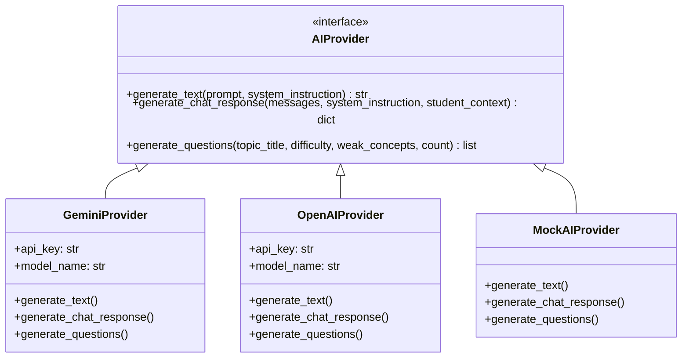
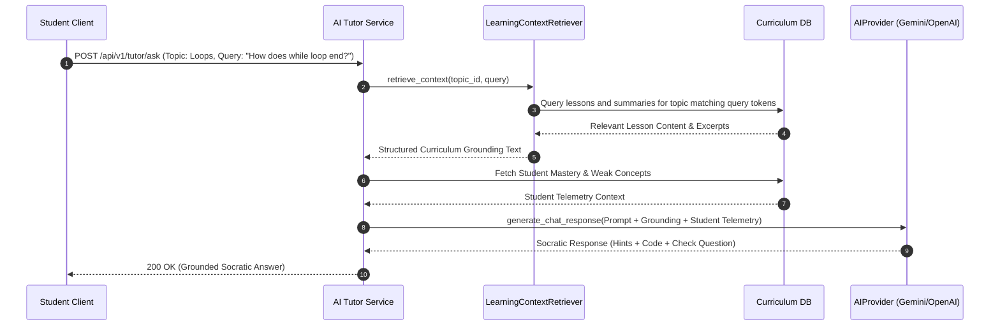

# AI Architecture & LLM Integration

## 1. Provider Abstraction Pattern

To avoid vendor lock-in, enable zero-cost offline development, and support seamless switching between frontier LLMs, the system implements an enterprise-grade `AIProvider` abstraction:



### Runtime Selection & Graceful Fallback
The active provider is chosen via the `AI_PROVIDER` environment variable:
- `gemini`: Uses Google Gemini models (default `gemini-1.5-flash`) via REST.
- `openai`: Uses OpenAI models (default `gpt-4o-mini`) via REST.
- `mock`: Uses built-in educational pedagogical simulator.

**Resilience Contract**: If network calls fail, rate limits are hit, or invalid API keys are supplied, both `GeminiProvider` and `OpenAIProvider` catch the exception, log the diagnostic error, and seamlessly fall back to `MockAIProvider`. This ensures students never experience broken chat sessions or blank screens.

---

## 2. Curriculum-Grounded RAG Pipeline (`LearningContextRetriever`)

A key flaw in naive AI tutors is hallucination: answering out-of-syllabus questions or using conventions unfamiliar to the student. LearnAI solves this with an in-process **Retrieval-Augmented Generation (RAG)** pipeline:



### Prompt Synthesis Flow:
```
[SYSTEM INSTRUCTION]
You are LearnAI's Socratic Tutor. Follow the pedagogical rules:
1. Break down concepts into intuitive steps.
2. Ground all explanations in the provided course curriculum.
3. Address the student's specific weak concepts without directly giving answers.
4. Conclude with 2 conceptual hints and 1 follow-up check question.

[CURRICULUM GROUNDING (FROM DATABASE)]
Course: Python Mastery
Topic: Loops & Iteration
Relevant Lesson Material:
- Lesson: While Loop Mechanics and Termination Conditions.
- Summary: A while loop repeats as long as its boolean condition evaluates to True. When the condition evaluates to False, control passes to the statement following the loop body. Infinite loops occur when the termination condition is never reached.

[STUDENT TELEMETRY]
Name: Alex Chen
Mastery Level: Developing (42.0%)
Weak Concepts: nested_loops, while_loop_termination
Strong Concepts: for_range

[CONVERSATION HISTORY]
Student: How does a while loop know when to stop?
```

---

## 3. Structured Question Synthesis & Schema Validation

When instructors request on-demand AI question generation via the Admin Portal, the engine enforces strict Pydantic schema validation:

```python
class GeneratedQuestionSchema(BaseModel):
    text: str = Field(..., min_length=10)
    options: dict[str, str] = Field(..., description="Must contain keys A, B, C, D")
    correct_answer: str = Field(..., pattern=r"^[A-D]$")
    explanation: str = Field(..., min_length=15)
    concept_tags: list[str] = Field(default_factory=list)
    difficulty: QuestionDifficulty
```

### Anti-Hallucination Measures:
1. **Schema Constraints**: Output format is explicitly forced to JSON. Raw responses are parsed and validated through `GeneratedQuestionSchema`.
2. **Key Verification**: `correct_answer` must exist as a key inside `options`.
3. **Plausibility Filters**: Options must contain 4 distinct, non-empty options.
4. **Curriculum Alignment**: Question prompts require matching the topic title and targeted weak concepts.
