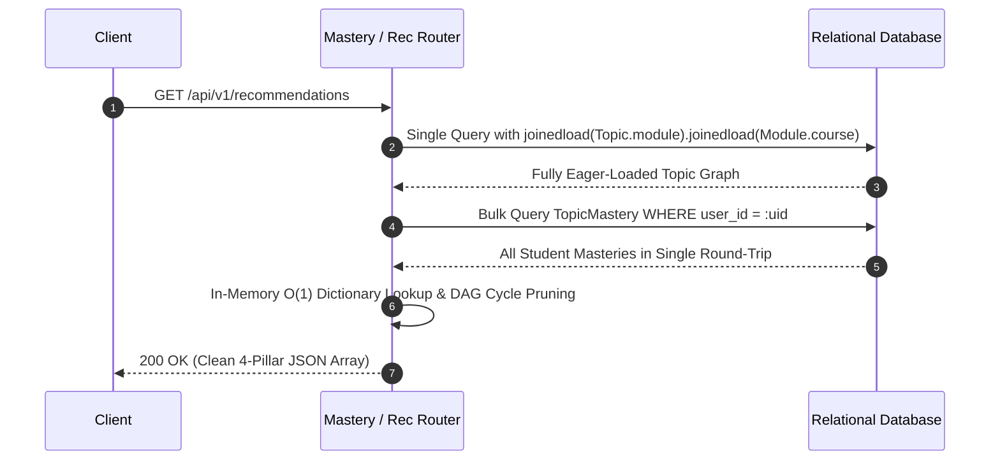
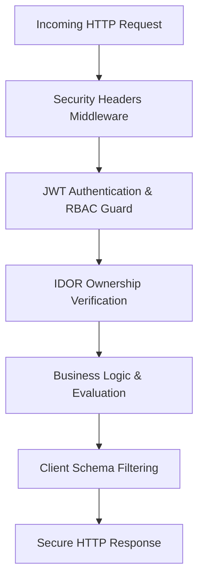

# System Architecture

## 1. Architectural Philosophy
The **AI-Powered Personalized Learning System (LearnAI)** is engineered as a **modular monolith** with clean domain separation. This design strikes the optimal balance between rapid iteration, transactional consistency, simplified observability, and low cognitive overhead while remaining interview-ready, robust, and horizontally scalable.

```mermaid
graph TD
    Client["React + TypeScript SPA (Vite + Tailwind)"]
    API["FastAPI Application Server"]
    DB[(PostgreSQL / SQLite Database)]
    Retriever["Curriculum Context Retriever (RAG)"]
    AI["AI Provider Abstraction Layer"]
    
    Client -->|REST + Signed JWT| API
    API -->|SQLAlchemy 2.0 ORM (Eager Joinedload)| DB
    API -->|Keyword & Topic Matching| Retriever
    Retriever -->|Curriculum Grounding| API
    API -->|Grounding + Telemetry Context| AI
    
    subgraph Core Engines
        MasteryEngine["Knowledge Mastery Engine (Dual-Window + Ebbinghaus Decay)"]
        RecEngine["Explainable Recommendation Engine (4-Pillar + DAG DFS)"]
        AdaptiveQuiz["Adaptive Assessment Engine (Anti-Cheat + Live Stepping)"]
    end
    
    API --> MasteryEngine
    API --> RecEngine
    API --> AdaptiveQuiz
```

---

## 2. Component Breakdown

### Frontend (Single Page Application)
- **Framework**: React 18 with TypeScript 5 and Vite 5.
- **Styling**: Tailwind CSS with custom palette, responsive containers, and dark-mode aesthetics.
- **State & Data Fetching**: TanStack Query (React Query v5) for automatic caching, query invalidation, background refetching, and zero stale UI states.
- **Routing**: React Router v6 with declarative `ProtectedRoute` and `AdminRoute` security guards.
- **Visual Analytics**: Recharts for dynamic multi-series visual charts (Mastery distribution bar chart, accuracy trajectories, and 7-day activity metrics).

### Backend (Modular Monolith)
- **Framework**: FastAPI (Asynchronous Python 3.11) with Pydantic v2 validation models.
- **Data Persistence**: SQLAlchemy 2.0 ORM utilizing declarative models, relationship indexes, and Alembic schema migrations.
- **Security & RBAC**: Stateless signed JWT tokens (`HS256`) with bcrypt salted password hashing, strict role enforcement (`student`, `teacher`, `admin`), and IDOR validation.
- **Telemetry & Event Bus**: Centralized `LearningEvent` tracking recording granular learning events (`lesson_started`, `quiz_completed`, `ai_question_asked`, etc.).

### AI & Knowledge Engineering
- **Decoupled Provider Pattern**: Unified `AIProvider` abstract interface with concrete implementations:
  - `GeminiProvider`: Google Gemini REST API integration.
  - `OpenAIProvider`: OpenAI REST API completion integration with JSON schema enforcement.
  - `MockAIProvider`: Pedagogically sound, deterministic fallback ensuring offline reliability.
- **Curriculum-Grounded RAG**: `LearningContextRetriever` extracts relevant lesson summaries and concepts from the relational database, grounding tutor prompts in actual curriculum facts to prevent hallucinations.

---

## 3. High-Performance Query Architecture & N+1 Prevention

To guarantee sub-50ms API response times even under high database concurrency, the backend strictly eliminates $O(N)$ query anti-patterns across all relational endpoints:



### Specific Query Optimizations Implemented:
1. **Mastery Summaries (`/api/v1/mastery/summary`)**:
   - Replaced per-topic mastery queries with a single eager-loaded join across `Topic`, `Module`, and `Course`.
   - Batch-fetches the user's `TopicMastery` records in a single query and maps them via an in-memory dictionary.
2. **Explainable Recommendations (`/api/v1/recommendations`)**:
   - Single joined fetch for topics and courses combined with bulk student mastery lookups.
   - Eliminates redundant queries during multi-factor scoring and prerequisite validation.
3. **Adaptive Assessments & Question Banks**:
   - Pre-loads question concept tags and answer options via `joinedload` on quiz initiation.
   - Batch-evaluates concept mistakes without querying the `questions` table inside loops.

---

## 4. Multi-Layer Security & Anti-Cheat Safeguards



1. **Strict Role-Escalation Immunity**:
   - Public registration endpoint (`POST /api/v1/auth/register`) unconditionally overrides requested roles to `UserRole.STUDENT`. Teacher and Admin roles can only be granted by existing administrators.
2. **In-Depth IDOR Ownership Defense**:
   - Attempt endpoints (`GET /api/v1/assessments/attempts/{id}` and `/attempts/{id}/review`) strictly verify that `attempt.user_id == current_user.id` or that `current_user.role == ADMIN`.
   - Study plan updates (`PUT /api/v1/study-plans/{id}/items/{item_id}`) verify ownership of the parent study plan before toggling completion status.
3. **Anti-Cheat Assessment Contracts**:
   - In-progress quiz requests serialize data through `QuestionClientResponse`, strictly omitting `correct_answer` and `explanation`.
   - Authoritative grading occurs exclusively on the backend server upon submission.
   - Submission idempotency guards in the adaptive quiz engine prevent duplicate submissions of the same question within an attempt.
4. **HTTP Security Headers Middleware**:
   - Injected on every response:
     - `X-Content-Type-Options: nosniff` (MIME-sniffing prevention)
     - `X-Frame-Options: DENY` (Clickjacking defense)
     - `X-XSS-Protection: 1; mode=block` (Cross-site scripting mitigation)
     - `Referrer-Policy: strict-origin-when-cross-origin` (Referrer leakage control)
5. **Centralized Exception Boundary**:
   - Global exception handler catches unhandled errors and logs detailed traces internally while returning standardized, safe error payloads (`"An internal error occurred. Please contact support."`) to avoid leaking database internals.

---

## 5. Lifespan Management & Health Observability

The application lifecycle is managed via modern FastAPI `lifespan` context managers:
- **Startup**: Initializes database connections, validates configuration parameters, and checks AI provider credentials.
- **Deep `/health` Diagnostic Probe**:
  - Executes a live SQL ping (`SELECT 1`) to ensure relational database pool health.
  - Inspects active AI provider configuration (`gemini`, `openai`, or `mock`).
  - Returns `200 OK` with structured health status or `503 Service Unavailable` if the database is unreachable.
