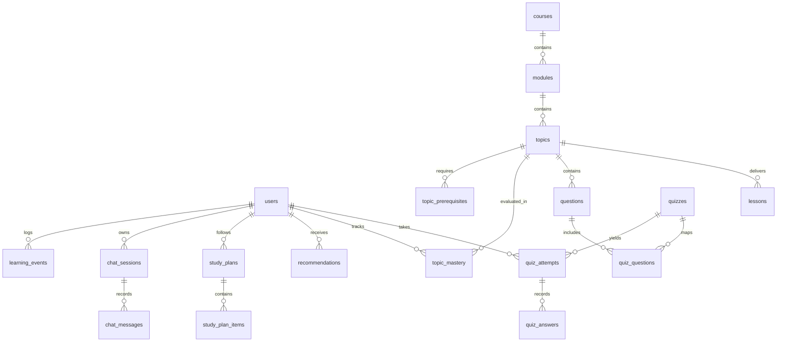

# Database Schema & Relational Modeling

## 1. Entity-Relationship Overview
The database employs 19 relational tables designed for third-normal form (3NF) compliance while supporting fast hierarchical retrieval and analytics queries.

---

## 2. Core Tables Specification

### Identity & Access Control
- `users`: Primary identity store (`id`, `email`, `hashed_password`, `full_name`, `role`, `is_active`, `created_at`).
  - Roles supported: `student`, `teacher`, `admin`.

### Curriculum Hierarchy
- `courses`: Top-level subject container (`id`, `title`, `slug`, `category`, `difficulty`, `thumbnail_url`).
- `modules`: Sequential milestones within a course (`id`, `course_id`, `title`, `order_index`).
- `topics`: Atomic learning units (`id`, `module_id`, `title`, `slug`, `estimated_minutes`).
- `topic_prerequisites`: Directed acyclic graph mapping prerequisite topic dependencies.
- `lessons`: Educational content with markdown body (`id`, `topic_id`, `content_markdown`, `duration_minutes`).
- `resources`: Auxiliary media links and code files.

### Assessment Engine
- `questions`: Item bank (`id`, `topic_id`, `question_text`, `options_json`, `correct_answer`, `difficulty`, `concept_tag`, `points`).
- `quizzes`: Assessment containers (`id`, `course_id`, `topic_id`, `is_adaptive`, `passing_score`).
- `quiz_attempts`: Student assessment sessions (`id`, `quiz_id`, `user_id`, `score`, `percentage`, `current_difficulty`, `passed`, `is_completed`).
- `quiz_answers`: Individual question submissions (`id`, `attempt_id`, `question_id`, `selected_answer`, `is_correct`, `points_awarded`, `time_spent_seconds`).

### Knowledge Tracing & Intelligence
- `topic_mastery`: Student competence tracker per topic (`id`, `user_id`, `topic_id`, `mastery_score`, `confidence`, `attempts_count`, `trend`, `weak_concepts`, `strong_concepts`).
- `recommendations`: 4-factor explainable recommendation records (`id`, `user_id`, `what_description`, `why_description`, `evidence_description`, `action_description`, `priority`).
- `learning_events`: Event telemetry (`id`, `user_id`, `event_type`, `entity_type`, `entity_id`, `event_data`, `created_at`).
- `study_plans` & `study_plan_items`: Weekly schedule milestones.
- `chat_sessions` & `chat_messages`: Contextual Socratic tutor dialogs.

---

## 3. Indexing Strategy
- Unique compound indexes on `(user_id, topic_id)` in `topic_mastery`.
- B-Tree indexes on `slug` and `email` for rapid lookups.
- Foreign key indexes on all child associations with `ON DELETE CASCADE`.
- Index on `learning_events.created_at` for high-performance streak and trend aggregations.
