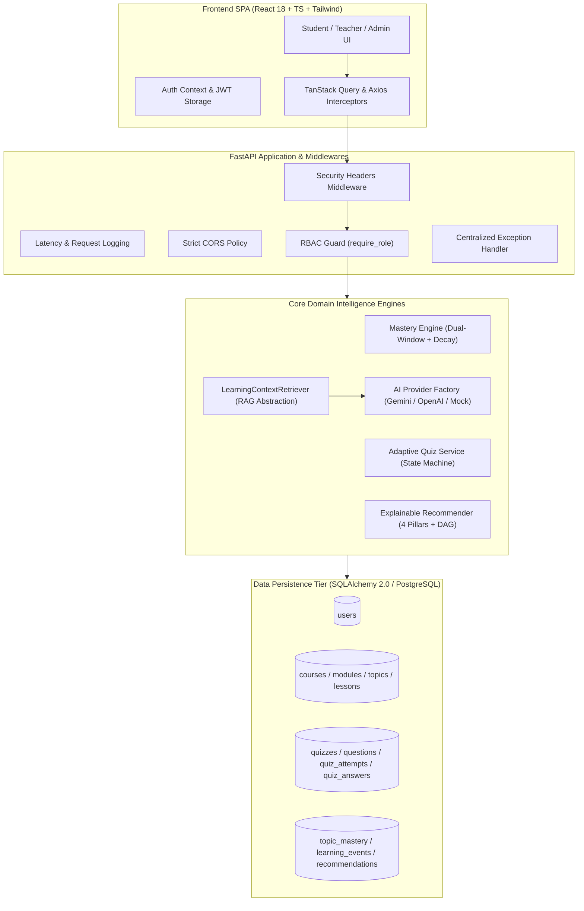
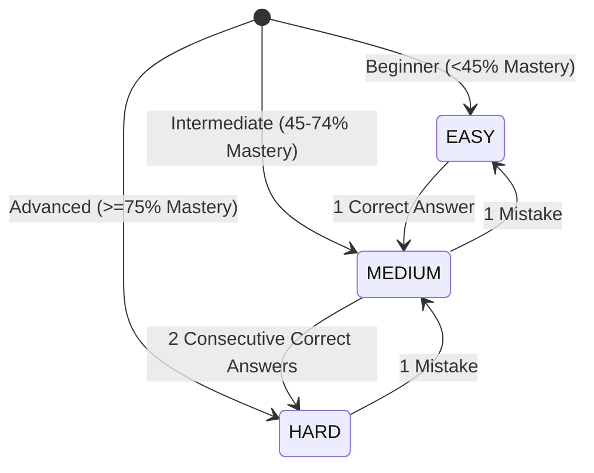

# Senior Engineering Interview & System Defense Guide

**Project:** LearnAI — AI-Powered Personalized Learning System  
**Architecture:** Production-Ready Modular Monolith (FastAPI + React TypeScript + PostgreSQL/SQLite + Docker)  
**Author / Lead:** Autonomous Lead Systems Architect

---

## 1. Executive Summary & 30-Second Pitch

> *"LearnAI is an enterprise-grade personalized learning platform designed to eliminate student knowledge gaps through real-time adaptive assessments, mathematically explainable recommendations, and RAG-grounded contextual AI tutoring.*  
> *Rather than treating learning like a flat CRUD application or relying on unverified LLM hallucinations, LearnAI models student understanding through a dual-window Bayesian mastery engine that tracks granular concept-level mistakes, counteracts Ebbinghaus forgetting decay, navigates prerequisite DAGs with cycle detection, and authoritative backend scoring that prevents client cheating."*

---

## 2. High-Level System Architecture & Flow



---

## 3. Mathematical Foundations of the Intelligence Engines

### A. Dual-Window Knowledge & Mastery Modeling
Typical LMS platforms average lifetime scores (penalizing early mistakes) or take the latest quiz score (introducing high variance). LearnAI employs a **Dual-Window Weighted Blend**:

$$\text{Blended Score} = (0.35 \times \text{Historical Accuracy}) + (0.65 \times \text{Recent Attempt Accuracy})$$

Where:
- $\text{Historical Accuracy} = \frac{\sum \text{Correct Answers}}{\sum \text{Total Answers}} \times 100$
- $\text{Recent Accuracy} = \frac{\text{Correct in Current Attempt}}{\text{Total in Current Attempt}} \times 100$

#### Difficulty Weighting Multiplier
To reward students for tackling harder items and adjust for easy quizzes:
$$\text{Adjusted Score} = \min(100.0, \max(0.0, \text{Blended Score} \times M_{\text{difficulty}}))$$

| Question Difficulty | Multiplier ($M_{\text{difficulty}}$) | Rationale |
|---|---|---|
| **EASY** | `0.95` | Standard beginner baseline reward |
| **MEDIUM** | `1.00` | Standard neutral baseline |
| **HARD** | `1.08` | Bonus reward for successfully solving advanced problems |

#### Asymptotic Confidence Estimator
A score derived from 2 questions has lower statistical certainty than a score derived from 40 questions. Confidence scales asymptotically towards $1.0$:
$$\text{Confidence} = \min\left(0.99, \max\left(0.15, \frac{\text{Total Questions Answered}}{20.0}\right)\right)$$

### B. Ebbinghaus Spaced Retention Decay
When a student neglects a mastered topic, memory decay occurs according to cognitive retention principles. If `days_inactive > 7`:

$$\text{Decay Factor} = \max\left(0.80, 1.0 - (0.01 \times \min(\text{days\_inactive} - 7, 20))\right)$$
$$\text{Decayed Score} = \text{Mastery Score} \times \text{Decay Factor}$$

- Maximum decay is capped at $20\%$ over 30 days of inactivity.
- Triggered automatically on read in `/api/v1/mastery/summary` and `/api/v1/recommendations`.

### C. Granular Concept Attribution
Every `Question` contains an indexed `concept_tag` (e.g. `nested_loops`, `recursion_base_case`). 
- On correct answers: tag is moved from `weak_concepts` to `strong_concepts`.
- On incorrect answers: tag is added to `weak_concepts`.

---

## 4. 4-Pillar Explainable Recommendation Engine

LearnAI never outputs black-box recommendations. Every recommendation satisfies the **4-Pillar Explainability Framework**:

1. **WHAT**: Actionable task (e.g., *"Targeted Remediation: Python Loops"*).
2. **WHY**: Pedagogical justification based on telemetry (e.g., *"Your mastery is currently 42% (Developing level) with a declining trend."*).
3. **EVIDENCE**: Quantitative proof from stored records (e.g., *"You answered 3 of 7 questions correctly (42.8% accuracy), with persistent mistakes in: nested_loops."*).
4. **ACTION**: Step-by-step resolution (e.g., *"Review the lesson 'While Loops' and take a 5-question adaptive quiz at easy difficulty."*).

### Prerequisite DAG Graph Traversal & Cycle Detection
To prevent circular prerequisite deadlocks (e.g. A depends on B and B depends on A), `RecommendationEngine` runs cycle detection via Depth-First Search (`_detect_and_prune_cycles`):
- Tracks `visited` and active recursion call stack `rec_stack`.
- If an edge targets a node currently in `rec_stack`, the cycle is detected, logged, and pruned.
- Unlocked topics require $100\%$ of prerequisite topics to have $\ge 65\%$ mastery.

---

## 5. Adaptive Quiz Engine: State Machine & Anti-Cheat



### Anti-Cheat & Security Guarantees
1. **Client Privacy**: The client quiz delivery contract (`QuestionClientResponse`) strips `correct_answer` and `explanation`.
2. **Authoritative Backend Scoring**: The client only sends `{attempt_id, question_id, selected_answer}`. Backend calculates correctness and difficulty points.
3. **Idempotency & Duplicate Shield**: Resubmitting the same question in the same attempt throws `400 Bad Request ("This question has already been answered for this attempt")`.
4. **Difficulty Points**: EASY = 1.0 pt, MEDIUM = 2.0 pts, HARD = 3.0 pts. Maximum score is dynamically computed from questions encountered.

---

## 6. RAG-Ready Content Architecture (`LearningContextRetriever`)

### Why RAG Over Fine-Tuning?
Curriculum text changes frequently, whereas fine-tuning is expensive, slow, and prone to hallucinating non-existent APIs. 
`LearningContextRetriever` abstracts content retrieval:
1. **Current Modular Monolith Phase**: Retrieves published markdown lessons, topic descriptions, and prerequisite outlines from relational tables using lexical indexing.
2. **Future Vector Search Phase**: Provides a drop-in interface where the retrieval implementation can swap to `pgvector` embeddings (`cosine_similarity(query_embedding, lesson_embedding)`) without modifying `AITutor` or `AdminQuestionGenerator` call sites.

---

## 7. Security Hardening & Zero-Trust RBAC

1. **Privilege Escalation Blocked**: Public registration (`/api/v1/auth/register`) strictly forces `role = UserRole.STUDENT`, completely neutralizing attempts to register as administrator or teacher.
2. **IDOR Protection**: All endpoints inspecting attempts, study plans, or recommendations enforce strict ownership checks (`attempt.user_id == current_user.id`).
3. **Enterprise Headers**: Every response returns `X-Content-Type-Options: nosniff`, `X-Frame-Options: DENY`, `X-XSS-Protection: 1; mode=block`, `Referrer-Policy: strict-origin-when-cross-origin`.
4. **Centralized Error Boundary**: FastAPI unhandled exception handler catches unexpected runtime errors, logs the full stack trace internally, and returns sanitized RFC-7807 problem details to the client.

---

## 8. Senior Technical Interview Defense Q&A

### Q1: How did you eliminate N+1 queries across the application?
**Answer**:
In our audit, we identified N+1 queries where endpoints iterated over items and queried the database inside loops (e.g. fetching `Question` for each answer, or `Topic` for each recommendation).
We refactored these to single-trip batch queries:
```python
# Before (N+1 query):
for a in answers:
    q = db.query(Question).filter(Question.id == a.question_id).first()

# After (1 bulk query):
q_ids = [a.question_id for a in answers]
q_map = {q.id: q for q in db.query(Question).filter(Question.id.in_(q_ids)).all()}
for a in answers:
    q = q_map.get(a.question_id)
```
Combined with SQLAlchemy `joinedload(Topic.module).joinedload(Module.course)`, we reduced dashboard and quiz evaluation database round-trips from $>50$ queries down to $3-4$ bulk queries.

### Q2: Why did you build a Modular Monolith instead of Microservices?
**Answer**:
For an educational platform handling assessments and student telemetry, transactional integrity (ACID) is paramount. When an attempt finishes, we update `quiz_attempts`, record `quiz_answers`, recalculate `topic_mastery`, and log `learning_events` in a single database transaction. 
In microservices, this would require distributed sagas, 2-phase commits, and message broker orchestration (Kafka), adding massive operational overhead and eventual consistency latency. Our modular monolith organizes domains into strict modules (`app/services/mastery_service.py`, `app/services/recommendation_service.py`, `app/services/adaptive_quiz_service.py`) that can be factored into microservices later if individual components need independent horizontal scaling.

### Q3: How do you handle external AI provider outages or rate limits?
**Answer**:
We implemented the Provider Pattern with an `AIProvider` abstract base class. Both `GeminiProvider` and `OpenAIProvider` wrap external REST calls with timeout guards and try-except blocks. If the external provider returns a 429 rate limit, 500 server error, or invalid JSON, it logs a warning and transparently delegates to `MockAIProvider`. The student experience remains uninterrupted.

### Q4: How would you scale this system to 1,000,000 active students?
**Answer**:
1. **Curriculum Read-Cache**: Cache courses, modules, topics, and lessons in Redis with 24-hour TTL; curriculum data is $99\%$ read and rarely updated.
2. **Read/Write DB Splitting**: Direct analytics, telemetry reads, and dashboard queries to PostgreSQL read replicas, reserving the primary instance for transactional quiz attempts.
3. **Asynchronous Event Ingestion**: Push `LearningEvent` rows into a message queue (Kafka / RabbitMQ / SQS) and batch-insert into PostgreSQL every 5 seconds.
4. **Stateless API Clustering**: FastAPI instances run containerized across Kubernetes or AWS ECS behind an ALB with autoscaling based on CPU/latency.
5. **pgvector Embeddings**: Migrate `LearningContextRetriever` to use `pgvector` HNSW indexes for sub-10ms semantic document retrieval.

### Q5: What database constraints prevent corrupted learning graphs?
**Answer**:
1. `UniqueConstraint("topic_id", "prerequisite_topic_id", name="uq_topic_prerequisite")` prevents duplicate prerequisite edges.
2. `UniqueConstraint("user_id", "topic_id", name="uq_user_topic_mastery")` guarantees atomic, single-record mastery tracking per student per topic.
3. `UniqueConstraint("attempt_id", "question_id", name="uq_attempt_question")` enforces question idempotency.
4. Indexed foreign keys (`topic_id`, `user_id`, `course_id`) ensure high-speed join queries.
