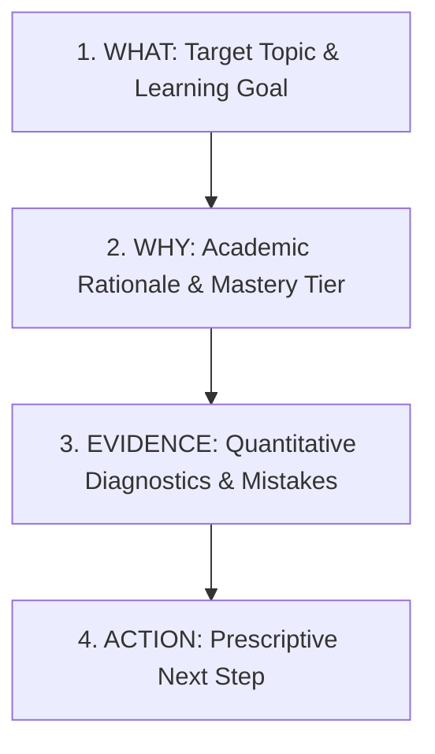
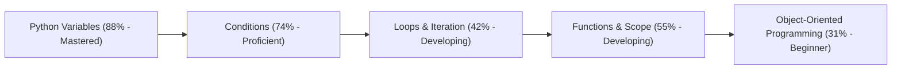

# Explainable Recommendation Engine

## 1. Engine Objective
The recommendation engine eliminates "black box" machine learning skepticism by providing 100% transparent, deterministic, and pedagogically grounded recommendations that answer two core questions:
1. **"What should this student learn next?"**
2. **"Why is this recommended?"**

---

## 2. The 4-Pillar Explainability Framework

Every recommendation generated by the engine adheres to a strict 4-pillar contract:



### Pillar Definitions:
- **WHAT**: The specific curriculum milestone, topic, or diagnostic exercise to engage.
- **WHY**: The pedagogical justification based on current mastery score, proficiency tier, and trajectory.
- **EVIDENCE**: Concrete diagnostic telemetry: past quiz accuracy, number of attempts, and recurring mistakes in specific concepts.
- **ACTION**: The exact sequence of steps (e.g., read Lesson 2, take a 5-question adaptive practice quiz).

---

## 3. Real-World Walkthrough (Alex Chen)

### Scenario: Alex Chen (Python Loops Mastery = 42%)
- **WHAT**:
  `Targeted Remediation: Loops & Iteration`
- **WHY**:
  `Your mastery is currently 42.0% (Developing tier) with a declining trend. Targeted focus here will prevent stumbling on advanced algorithms.`
- **EVIDENCE**:
  `You have answered 6 of 14 questions correctly (42.9% accuracy), with persistent mistakes in: nested_loops, while_loop_termination.`
- **ACTION**:
  `Review the lesson 'Nested Loops and Complexity Patterns' and take a 5-question adaptive quiz at easy-to-medium difficulty.`

---

## 4. Priority Scoring Algorithm

The engine generates candidates across all available topics and scores them using a multi-factor objective function:

$$P = w_1 \cdot (1 - \hat{M}) + w_2 \cdot E_{rec} + w_3 \cdot D_{decay} + w_4 \cdot U_{unlock}$$

Where:
- $\hat{M} = \frac{\text{Mastery}}{100} \in [0, 1]$: Inverted mastery score (lower mastery receives higher priority).
- $E_{rec}$: Recent mistake severity indicator ($1.0$ if recurring weak concepts exist, else $0.0$).
- $D_{decay}$: Retention decay factor based on days since last activity ($> 7$ days triggers bonus urgency).
- $U_{unlock}$: Dependency impact score based on how many downstream topics depend on this topic.
- Weights: $w_1 = 0.40, w_2 = 0.25, w_3 = 0.20, w_4 = 0.15$.

Recommendations are sorted descending by $P$, and the top recommendations are selected.

---

## 5. Prerequisite DAG Traversal & Cycle Detection

Curriculum topics form a Directed Acyclic Graph (DAG) defined by the `TopicPrerequisite` relation.



### Prerequisite Unlocking Rules:
1. A topic is **Locked** if any prerequisite topic maintains a mastery score $< 65\%$.
2. If a student attempts to access or is evaluated for an advanced topic with unmet prerequisites, the engine prioritizes the prerequisite topic first to resolve learning debt.

### Cycle Detection Algorithm (DFS):
To defend against circular dependencies introduced by curriculum editors (e.g., $A \to B \to C \to A$), the engine implements a cycle-detection pass using Depth-First Search with recursion stack tracking:

```python
def _detect_and_prune_cycles(adj_list: dict[int, list[int]]) -> dict[int, list[int]]:
    visited = set()
    rec_stack = set()
    pruned_adj = {k: [] for k in adj_list}

    def dfs(node: int):
        visited.add(node)
        rec_stack.add(node)
        for neighbor in adj_list.get(node, []):
            if neighbor not in visited:
                pruned_adj[node].append(neighbor)
                dfs(neighbor)
            elif neighbor in rec_stack:
                # Cycle detected! Discard this backward edge to maintain DAG property
                logger.warning(f"Circular dependency detected between {node} and {neighbor}. Pruning edge.")
            else:
                pruned_adj[node].append(neighbor)
        rec_stack.remove(node)

    for node in adj_list:
        if node not in visited:
            dfs(node)
    return pruned_adj
```

---

## 6. Retention Decay Integration (Ebbinghaus Forgetting Curve)

For students who have not reviewed a topic in over 7 days, the engine dynamically applies memory decay:

$$M_{\text{decayed}} = M_{\text{stored}} \cdot e^{-\frac{\Delta t}{14}}$$

Where $\Delta t$ is the elapsed days since last practice. If $M_{\text{decayed}} < M_{\text{stored}}$, the decayed score is persisted and a **Spaced Retention Review** recommendation is triggered:
- **WHAT**: `Spaced Retention Review: [Topic Name]`
- **WHY**: `It has been [N] days since you last practiced this topic. Spaced review prevents memory decay.`
- **EVIDENCE**: `Your mastery decayed from [Previous]% to [Current]% due to inactivity.`
- **ACTION**: `Complete a short 3-minute refresher quiz to reinforce your neural retrieval pathways.`

---

## 7. Performance & High-Concurrency Scaling

In traditional implementations, generating recommendations requires iterating over every topic and querying the database for prerequisites and student attempts, causing $O(N)$ query cascades.

In LearnAI, this is solved via:
1. **Bulk Topic & Prerequisite Loading**: All topics and prerequisite edges are loaded in a single join query.
2. **Single User Mastery Fetch**: All `TopicMastery` records for the user are fetched via `WHERE user_id = :uid` and indexed in a Python dictionary.
3. **In-Memory Graph Traversal**: Traversal, cycle checks, and formula scoring run entirely in memory in under 5 milliseconds.
